# Architecture & module system

_Last modified: 2026-10-15_

For *why* this repo runs flake-parts at all, see [flake-parts.md](flake-parts.md)
first — this page is the mechanism built on top of that, not the reason for
it. For what's actually inside each individual category — members, which
hosts import it, category-specific traps — see the
[category reference](categories/00-INDEX.md) instead of this page; this page
is the mechanism, not the inventory.

## Contents

- [The core mechanism](#the-core-mechanism)
- [The layout at a glance](#the-layout-at-a-glance)
- [Home Manager integration](#home-manager-integration)
- [Package modules](#package-modules)
- [Related, easy to get backwards](#related-easy-to-get-backwards)

## The core mechanism

- **[`../flake/doc/dirsAsCategory.md`](<../flake/doc/dirsAsCategory.md>)** —
  the load-bearing one. Every `.nix` file under `flake/modules/` is a
  flake-parts module (`flake.modules.<class>.<name> = ...`), and which
  category it belongs to is derived from the directory it's filed in, not
  declared explicitly. Read this before touching any `dirsAsCategory.nix`.
  What each category collects is also published as data:
  `nix eval --json ./flake#categoryGraph` (its directory, the module files
  it collects itself, and the categories nested in it).
- **[`../CLAUDE.md`](../CLAUDE.md), Architecture section** — the prose
  overview: `import-tree`, entry points that sit outside every category tree
  (`modules/checks.nix`, `host-config/hosts.nix`, the per-host configs,
  `users-config/elly-home-manager.nix`), and which categories aren't imported by
  every host (`virtualization` is the running example — cube only as of
  2026-08-27, deliberately absent on the handhelds and, since that date, on
  durandal too — see [`categories/virtualization.md`](categories/virtualization.md)).
- **[where-modules-go.md](where-modules-go.md)** — which of the three
  places a module belongs in: the shared tree (`general-config/`,
  `packages-config/`), a host's directory under `host-config/`, or a
  user's under `users-config/` — and the naming rule that goes with each.
- **Skill `new-flake-module`** (`.agents/skills/new-flake-module/SKILL.md`)
  — the traps in *writing* one: `flake.modules` can't live inside
  `perSystem`, a module's name comes from its filename so a rename can
  silently drop it from its category, two modules with the same name merge
  rather than conflict, and module classes aren't validated until the import
  site fails.

## The layout at a glance

The top of the tree, drawn from the files: each area directory, then the
categories directly in it. `n h d` are the classes a category carries
(nixos, homeManager, darwin) and the number is how many modules it holds,
nested categories included. A dashed outline is a category reached only
through modules a host names one by one; a red outline is one no host
imports. Per-category and per-host diagrams are on-demand, not committed:
`just module-graph tree --category homelab`, `just module-graph hosts`, and
`dot` for Graphviz (`just module-graph dot --view hosts`).

```mermaid
flowchart LR
    n0["general-config"]
    n1["host-config"]
    n2["packages-config"]
    n3["users-config"]
    n4["boot/<br/>n · 2"]
    n5["desktop-env/<br/>n · 4"]
    n6["hardware/<br/>n · 2"]
    n7["homelab/<br/>n · 21"]
    n8["impermanence/<br/>n h · 2"]
    n9["macos/<br/>d · 3"]
    n10["nix/<br/>n h d · 2"]
    n11["peripherals/<br/>n · 2"]
    n12["shell-config/<br/>n h · 4"]
    n13["system/<br/>n h d · 44"]
    n14["cube/<br/>n · 9"]
    n15["durandal/<br/>n · 6"]
    n16["lysithea/<br/>d · 2"]
    n17["tenacity/<br/>n h · 11"]
    n18["development/<br/>n h · 17"]
    n19["editors/<br/>n h · 3"]
    n20["gui-other/<br/>h · 20"]
    n21["linux-utils/<br/>h · 17"]
    n22["nix-utils/<br/>n h · 4"]
    n23["shell-apps/<br/>n h · 40"]
    n24["terminals/<br/>h · 3"]
    n25["elly/<br/>n h d · 4"]
    n0 --> n4
    n0 --> n5
    n0 --> n6
    n0 --> n7
    n0 --> n8
    n0 --> n9
    n0 --> n10
    n0 --> n11
    n0 --> n12
    n0 --> n13
    n1 --> n14
    n1 --> n15
    n1 --> n16
    n1 --> n17
    n2 --> n18
    n2 --> n19
    n2 --> n20
    n2 --> n21
    n2 --> n22
    n2 --> n23
    n2 --> n24
    n3 --> n25
    classDef area fill:#eee,stroke:#888
    classDef category fill:#dbeafe,stroke:#2563eb
    classDef module fill:#fff,stroke:#555
    classDef aggregate fill:#fef3c7,stroke:#b45309
    classDef missing fill:#fee2e2,stroke:#b91c1c
    classDef orphan fill:#fff,stroke:#dc2626,stroke-width:3px,color:#b91c1c
    classDef bymodule stroke-dasharray:5 3
    classDef merges stroke:#dc2626,stroke-width:3px
    class n0,n1,n2,n3 area
    class n4,n5,n6,n7,n8,n9,n10,n11,n12,n13,n14,n15,n16,n17,n18,n19,n20,n21,n22,n23,n24,n25 category
    class n5 bymodule
```

<!-- generated:module-layout -- from the dirsAsCategory.nix tree under flake/modules/, drawn by flake/scripts/module-graph.py, by `just wiki-gen`; change the source, not this table -->

<!-- /generated -->

## Home Manager integration

- **[`../flake/doc/trailhead-home-manager-standalone.md`](<../flake/doc/trailhead-home-manager-standalone.md>)**
  — HM is wired in from the NixOS side (`useGlobalPkgs`/`useUserPackages`),
  not as a standalone `homeConfigurations` output. This doc is the trailhead
  back to standalone if that's ever wanted.
- **Skill `home-manager-dotfiles`**
  (`.agents/skills/home-manager-dotfiles/SKILL.md`) — traps specific to
  shell/dotfile modules: `home.file.<n>.text` and `home.sessionPath`
  concatenate rather than override across modules, reading a generated
  dotfile back has false negatives, and shell rc ordering
  (`mkBefore` → `mkOrder 550` → plugins → unordered) silently orphaned a
  hand-written `starship init` once.

## Package modules

- **Skill `package-platform-support`**
  (`.agents/skills/package-platform-support/SKILL.md`) — the two
  different questions that both show up as an `isDarwin` guard: can nixpkgs
  build it on darwin at all (automatic, from `meta.platforms`) vs. does
  Homebrew already install it on lysithea (never automatic — `just available
  --duplicates` finds the overlap). Worked examples: `vicinae.nix`,
  `obsidian.nix`.
## Related, easy to get backwards

Containers and VMs are separate categories here, and "virtualization" means
only the VM one (`general-config/homelab/virtualization/`: libvirt, virt-tools,
vm-networking — optional, cube only). Podman/distrobox live in
[`general-config/homelab/containers/`](categories/containers.md), its own category
since 2026-08-22, nested under the `homelab` umbrella since 2026-08-27 —
imported by cube only (durandal dropped it 2026-08-27, same day as
`virtualization`; tenacity 2026-09-26). See
[`categories/homelab.md`](categories/homelab.md) and
`.agents/rules/homelab.md`. A stale memory of "virtualization is the podman one"
is exactly backwards.
