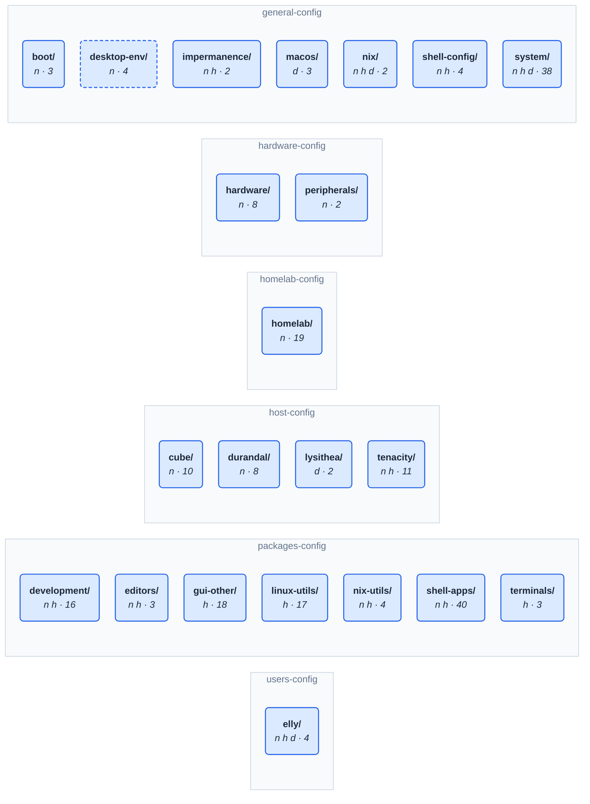

# Architecture & module system

_Last modified: 2026-10-28_

`flake.nix` is a manifest: it reads every `.nix` file under `flake/modules/`
and fills `flake.modules.<class>.<name>` from them. A folder holding modules
is a category, and a host includes categories by name. For why the repo uses
flake-parts, see [flake-parts.md](flake-parts.md). For one category's
members, importing hosts and traps, see the
[category reference](categories/00-INDEX.md).

## Contents

- [Quick facts](#quick-facts)
- [The core mechanism](#the-core-mechanism)
- [The layout at a glance](#the-layout-at-a-glance)
- [Home Manager integration](#home-manager-integration)
- [Package modules](#package-modules)
- [Related, easy to get backwards](#related-easy-to-get-backwards)

## Quick facts

The mechanism in one table; the sections below link the reasoning.

| what | where / how |
|---|---|
| a module | a `.nix` under `flake/modules/` keyed by class (`{ nixos = …; }`); its name is its filename; dirs-as-categories (a flake input) turns it into `flake.modules.<class>.<name>` -- [module-files.md](module-files.md) |
| a class | the module system the config is for: `nixos`, `darwin`, `homeManager` |
| a category | a folder with a subfolder holding modules (or `folderIsCategory`); includes every module beneath it, nested categories included; hosts `includes` categories by name |
| the rules | the `dirs-as-categories` input (`flake/flake.nix`); its `doc/convention.md`, and [module-files.md](module-files.md) for this repo |
| membership as data | `nix eval --json ./flake#moduleGraph` |
| checks | evaluation refuses repeated names, unknown keys and unknown `includes`; `just modules`: orphans, untracked, drift (`nix flake check`'s `module-orphans` fails only when built) |
| diagrams | `just module-graph tree`, `hosts`, `dot`, `html` (`--category`, `--depth`, `--wrap`); the flake-module-graph input |
| Home Manager | integrated through NixOS, no `homeConfigurations`; `just switch` applies both |

## The core mechanism

- **[module-files.md](module-files.md)** — the load-bearing one. A module
  file is keyed by class and named after its file, and which category it
  belongs to is derived from the folder it's filed in, not declared. The
  `dirs-as-categories` flake input applies those rules and publishes what it
  built as data: `nix eval --json ./flake#moduleGraph` (categories, modules
  and their classes, `includes`, `enables`).
  [`../../flake/doc/dirsAsCategory.md`](<../../flake/doc/dirsAsCategory.md>) is
  the shim-based design it replaced on 2026-10-16, kept as history.
- **[`../../CLAUDE.md`](../../CLAUDE.md), Architecture section** — the prose
  overview: `dirs-as-categories`, entry points that sit outside every category
  (`host-config/hosts.nix`, the per-host configs,
  `users-config/elly-home-manager.nix`), and which categories aren't imported by
  every host (`virtualization` is the running example, deliberately absent on the
  handhelds — see [`categories/virtualization.md`](categories/virtualization.md)
  for which hosts import it).
- **[where-modules-go.md](where-modules-go.md)** — which of the three
  places a module belongs in: the shared tree (`general-config/`,
  `packages-config/`), a host's directory under `host-config/`, or a
  user's under `users-config/` — and the naming rule that goes with each.
- **Skill `new-flake-module`** (`.agents/skills/new-flake-module/SKILL.md`)
  — the traps in *writing* one: a module's name is its filename so a
  rename renames it, a repeated name stops evaluation (it used to merge
  silently), and a new subfolder can make a folder a category.

## The layout at a glance

The top of the tree, drawn from the files: each area directory, then the
categories directly in it. `n h d` are the classes a category carries
(nixos, homeManager, darwin) and the number is how many modules it holds,
nested categories included. Per-category and per-host diagrams are
on-demand, not committed: `just module-graph tree --category homelab`,
`just module-graph hosts`, `dot` for Graphviz
(`just module-graph dot --view hosts`), and `html` for an interactive page
of the hosts view (`just module-graph html > modules.html`): click hosts to
show only what they import.

Every diagram uses one colour standard, keyed on what a host can include:

- **Blue, rounded: an importable category.** A host can include it by
  name. An edge into one is dotted:
  it is importable alone and also collected by the category above it.
  A category that holds nested categories (`development`, `homelab`) is a
  pale blue box around them instead of a card, titled with its name,
  classes and module count; edges into it end at the box.
- **Slate, square-cornered (a folder in Graphviz): an implicit folder.** A
  plain directory inside a category; its modules arrive only through that
  category.
- **White: a module.** Also when a host names one directly (`kde-desktop`):
  importable means a category, never a single module.
- **Outline overlays on a category:** dashed when it is reached only
  through modules a host names one by one; red when no host imports it.

The hosts view runs top-down: the host's and user's own directories
(`host-config/<host>/`, `users-config/<user>/`) sit above the hosts, and
the shared categories they import below, wrapped into rows
(`--wrap N` sets the width), each host's edges in its own colour (never blue or red). In
Mermaid an edge up into the top row is a plain line, not an arrow.

<!-- generated:module-layout -- from the categories under flake/modules/, drawn by the flake-module-graph input, by `just wiki-gen`; change the source, not this table -->

<!-- /generated -->

## Home Manager integration

- **[`../../flake/doc/trailhead-home-manager-standalone.md`](<../../flake/doc/trailhead-home-manager-standalone.md>)**
  — HM is wired in from the NixOS side (`useGlobalPkgs`/`useUserPackages`),
  not as a standalone `homeConfigurations` output. This doc is the trailhead
  back to standalone if that's ever wanted.
- **Skill `home-manager-dotfiles`**
  (`.agents/skills/home-manager-dotfiles/SKILL.md`) — traps specific to
  shell/dotfile modules: `home.file.<n>.text` and `home.sessionPath`
  concatenate rather than override across modules, reading a generated
  dotfile back has false negatives, and shell rc ordering
  (`mkBefore` → `mkOrder 550` → plugins → unordered) silently orphaned a
  hand-written `starship init` once.

## Package modules

- **Skill `package-platform-support`**
  (`.agents/skills/package-platform-support/SKILL.md`) — the two
  different questions that both show up as an `isDarwin` guard: can nixpkgs
  build it on darwin at all (automatic, from `meta.platforms`) vs. does
  Homebrew already install it on lysithea (never automatic — `just available
  --duplicates` finds the overlap). Worked examples: `vicinae.nix`,
  `obsidian.nix`.
## Related, easy to get backwards

Containers and VMs are separate categories here, and "virtualization" means
only the VM one (`homelab-config/homelab/virtualization/`: libvirt,
libvirt-persist, virt-tools, vm-egress-dns, vm-networking — cube only). Podman/distrobox live in
[`homelab-config/homelab/containers/`](categories/containers.md), its own category
since 2026-08-22, nested under the `homelab` umbrella since 2026-08-27 —
imported by cube only (durandal dropped it 2026-08-27, same day as
`virtualization`; tenacity 2026-09-26). See
[`categories/homelab.md`](categories/homelab.md) and
`.agents/rules/homelab.md`. A stale memory of "virtualization is the podman one"
is exactly backwards.
